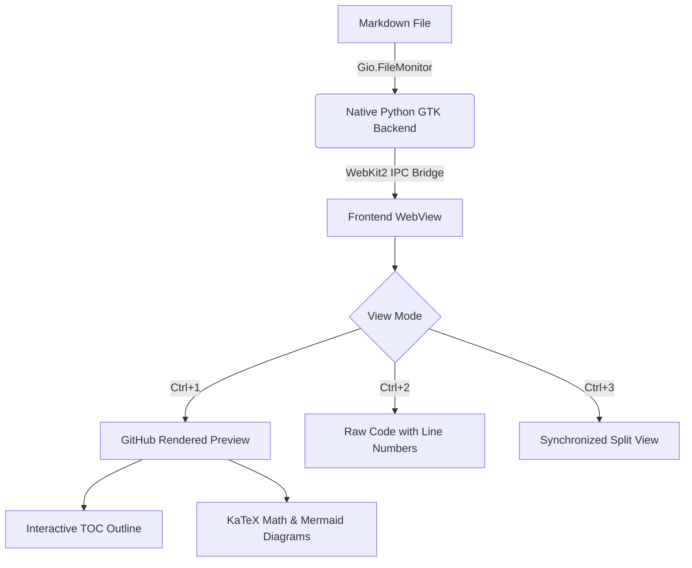
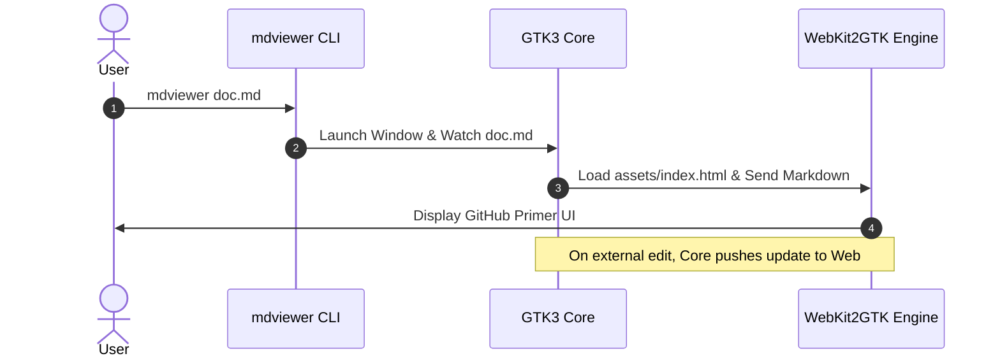

# md viewer

A sleek, ultra-fast, and native Markdown viewer & Architecture Studio for Linux. Built with **GTK 3** and **WebKit2GTK** to deliver a smooth, responsive interface with zero latency.

---

## Highlights & Features

- [x] **Native Linux Integration**: GTK 3 desktop application with instant startup (<150ms).
- [x] **Authentic GitHub Primer UI**: Pixel-perfect typography, breadcrumbs, statistics, and dark/light themes.
- [x] **Three View Modes**: Rendered Preview, Raw Markdown Code, and Synchronized Split View.
- [x] **GitHub Alert Callouts**: Support for `[!NOTE]`, `[!TIP]`, `[!IMPORTANT]`, `[!WARNING]`, and `[!CAUTION]`.
- [x] **Live File Auto-Reload**: Automatically detects file modifications and preserves scroll position.
- [x] **Interactive Outline**: Collapsible Table of Contents with active section tracking.
- [x] **Mathematical Expressions**: LaTeX formulas rendered with KaTeX.
- [x] **Mermaid Diagrams**: Flowcharts, sequence diagrams, and architecture graphs.
- [ ] **Export Options**: One-click print or export to PDF.

---

## GitHub Alert Callouts

> [!NOTE]
> This is a GitHub **Note** alert callout used to highlight important contextual information.

> [!TIP]
> Pro-tip: You can toggle the Table of Contents drawer using the **Outline** button or by pressing <kbd>Ctrl</kbd> + <kbd>Shift</kbd> + <kbd>O</kbd>.

> [!IMPORTANT]
> All vendor dependencies (Marked, Prism, KaTeX, and Mermaid) are bundled offline inside the application, requiring zero internet connection!

> [!WARNING]
> Live file watching is active by default. Modifying this file externally will seamlessly refresh the preview without losing your reading location.

> [!CAUTION]
> Ensure you save any external changes before closing the application to prevent data loss.

---

## Code Syntax Highlighting

Here are sample syntax-highlighted code blocks with language badges and one-click copy buttons.

### Python Example

```python
import os
import sys
from dataclasses import dataclass

@dataclass
class DocumentMetadata:
    title: str
    line_count: int
    word_count: int
    is_saved: bool = True

    def calculate_read_time(self, words_per_minute: int = 200) -> float:
        """Calculate estimated reading time in minutes."""
        return max(1.0, round(self.word_count / words_per_minute, 1))

doc = DocumentMetadata(title="README.md", line_count=142, word_count=850)
print(f"Reading time for '{doc.title}': {doc.calculate_read_time()} min")
```

### TypeScript / Modern JavaScript

```typescript
interface ViewerConfig {
  theme: 'dark' | 'light' | 'high-contrast';
  liveWatch: boolean;
  autoScroll: boolean;
  fontSize: number;
}

export async function renderDocument(path: string, config: ViewerConfig): Promise<boolean> {
  console.log(`Loading document from ${path} with theme ${config.theme}...`);
  const response = await fetch(path);
  return response.ok;
}
```

### Bash Command

```bash
# Launch markdown viewer with a file
mdviewer README.md

# Open with light theme
mdviewer sample.md --theme light
```

---

## Mathematical Equations (KaTeX)

Inline formulas like Einstein's mass-energy equivalence $E = mc^2$ and Euler's formula $e^{i\pi} + 1 = 0$ work seamlessly.

### Gaussian Integral

$$\int_{-\infty}^{\infty} e^{-x^2} \, dx = \sqrt{\pi}$$

### Schrödinger Equation

$$i\hbar \frac{\partial}{\partial t}\Psi(\mathbf{r},t) = \left[ -\frac{\hbar^2}{2m}\nabla^2 + V(\mathbf{r},t) \right] \Psi(\mathbf{r},t)$$

---

## Mermaid Visualizations



### Sequence Flow



---

## Formatted Data Tables

| Feature | mdviewer (Native) | Electron Apps | Browser Extensions |
| :--- | :---: | :---: | :---: |
| **Startup Time** | **< 150 ms** | 1.5 - 3.0 s | ~800 ms |
| **RAM Usage** | **~45 MB** | 250 - 450 MB | Browser overhead |
| **Offline Ready** | **100% Yes** | Yes | Depends on CDN |
| **Native Theme** | **GNOME / Primer** | Custom web chrome | Browser wrapper |
| **Split View** | **Synchronized** | Varies | Rarely supported |

---

## Keyboard Shortcuts Quick Reference

| Shortcut | Action |
| :--- | :--- |
| <kbd>Ctrl</kbd> + <kbd>O</kbd> | Open another markdown file |
| <kbd>Ctrl</kbd> + <kbd>F</kbd> | Find in page with match navigation |
| <kbd>Ctrl</kbd> + <kbd>1</kbd> | Switch to **Preview** mode |
| <kbd>Ctrl</kbd> + <kbd>2</kbd> | Switch to **Raw Code** mode |
| <kbd>Ctrl</kbd> + <kbd>3</kbd> | Switch to **Split** view mode |
| <kbd>Ctrl</kbd> + <kbd>Shift</kbd> + <kbd>O</kbd> | Toggle **Outline** (Table of Contents) |
| <kbd>Ctrl</kbd> + <kbd>Shift</kbd> + <kbd>C</kbd> | Copy raw markdown text |
| <kbd>Ctrl</kbd> + <kbd>P</kbd> | Print or Export to PDF |

---

> Crafted for Linux developers and researchers who demand speed, clarity, and GitHub's iconic reading experience.
